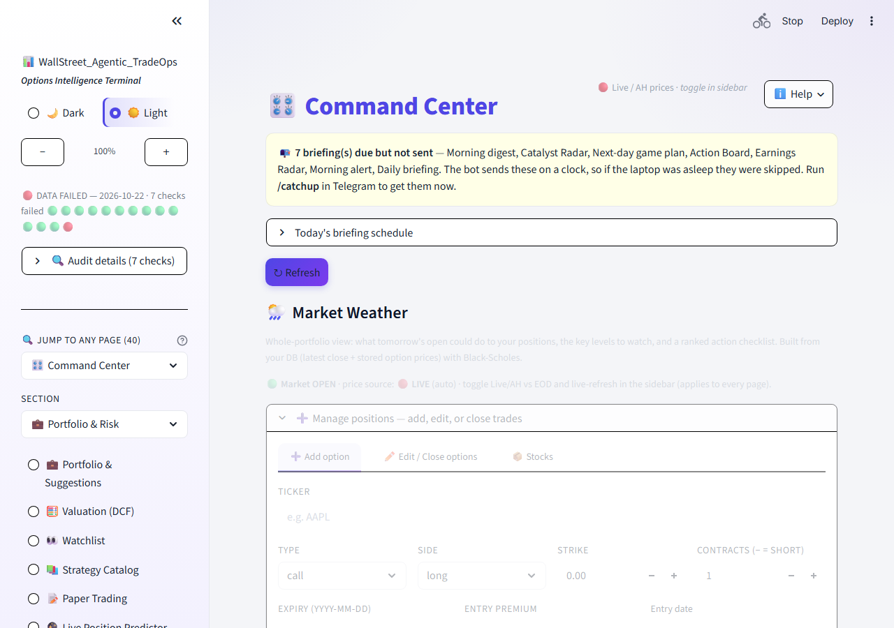
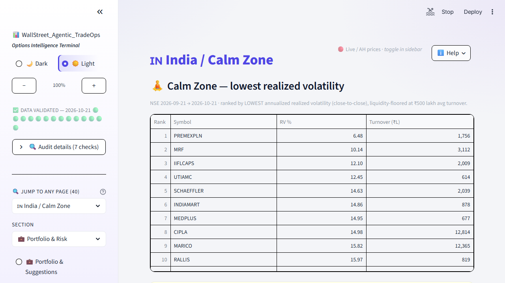
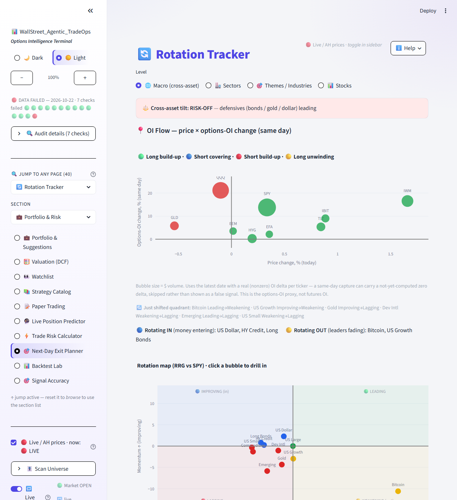
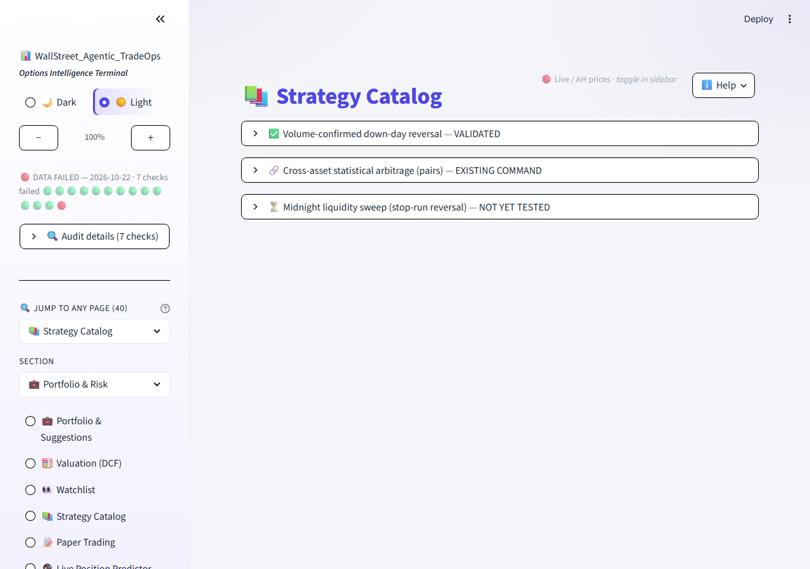

# WallStreet Agentic TradeOps

A personal options-trading intelligence terminal — a Telegram bot and a Streamlit dashboard
sharing one engine, built on top of a self-maintained SQLite market database (options chains,
daily OHLCV, 13F institutional filings).

**This repo is a showcase only — screenshots and a description, no source code.** The engine
lives in a private repository.

## What it does

- **Options analytics**: gamma exposure (GEX) with zero-gamma flip and call/put walls, max
  pain, implied-vol skew, vertical-spread and wheel/covered-call screeners, iron condors, an
  ensemble of ~24 signal models with their own walk-forward-validated hit rates.
- **Cross-asset rotation**: an RRG-style leadership/momentum map across equities, bonds, gold,
  commodities, and crypto, plus a per-asset options-OI flow view (long build-up / short
  covering / short build-up / long unwinding).
- **Institutional tracking**: 13F filings from ~20 tracked funds, quarter-over-quarter position
  changes, aggregated against SEC disclosures (257k+ holdings rows).
- **Signal validation lab**: every signal is backtested with daily cross-sectional IC and
  walk-forward refitting — never a pooled in-sample statistic — with a public "strategy
  catalog" that honestly labels each idea VALIDATED / EXISTING COMMAND / NOT YET TESTED. No
  fabricated backtest numbers ship.
- **Portfolio tools**: a Black-Scholes position monitor, tax-lot tracking (short/long-term
  clock, wash-sale and protective-put rules), paper trading, and a daily "exit planner" brief.
- **India (NSE) coverage**: EOD movers with delivery % (volume actually taken to delivery vs.
  squared off intraday — not published on the US tape), and a low-realized-volatility screener.

## Stack

Python · python-telegram-bot · Streamlit · SQLite · pandas/numpy · yfinance / OpenBB / Finnhub
market data · scheduled jobs for end-of-day capture and derived analytics · deployed on an
Oracle Cloud VM.

## Screenshots

### Command Center
One page for the whole system: market weather, open positions, top consensus ideas, today's
fired signals.

### Calm Zone (India)
A low-realized-volatility screener for NSE names, liquidity-floored and filtered for
money-market/index-fund contamination.

### Rotation Tracker + OI Flow
Cross-asset leadership/momentum map (RRG vs. SPY) with a per-asset options open-interest
flow quadrant layered in.

### Strategy Catalog
Every candidate strategy with an honest status — real stats once validated, a pointer to an
existing command if duplicated, or a plain "not yet tested" if it isn't.

---

*Personal project, not investment advice. Market data used under personal-use licensing; this
showcase contains no live quotes, positions, or vendor data redistribution.*
