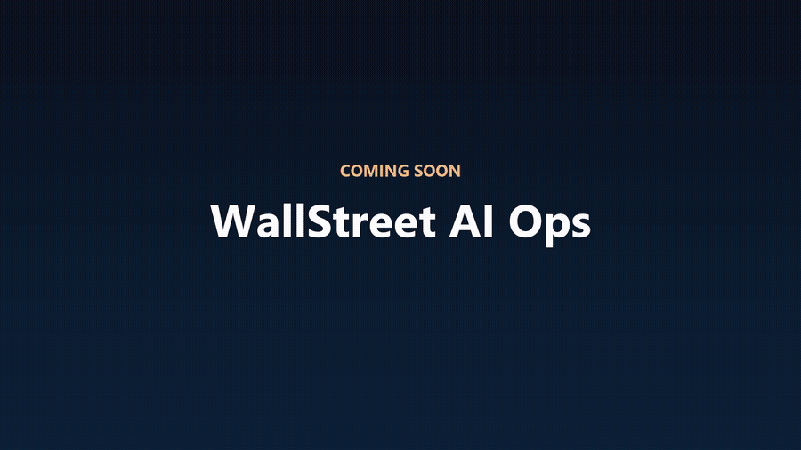
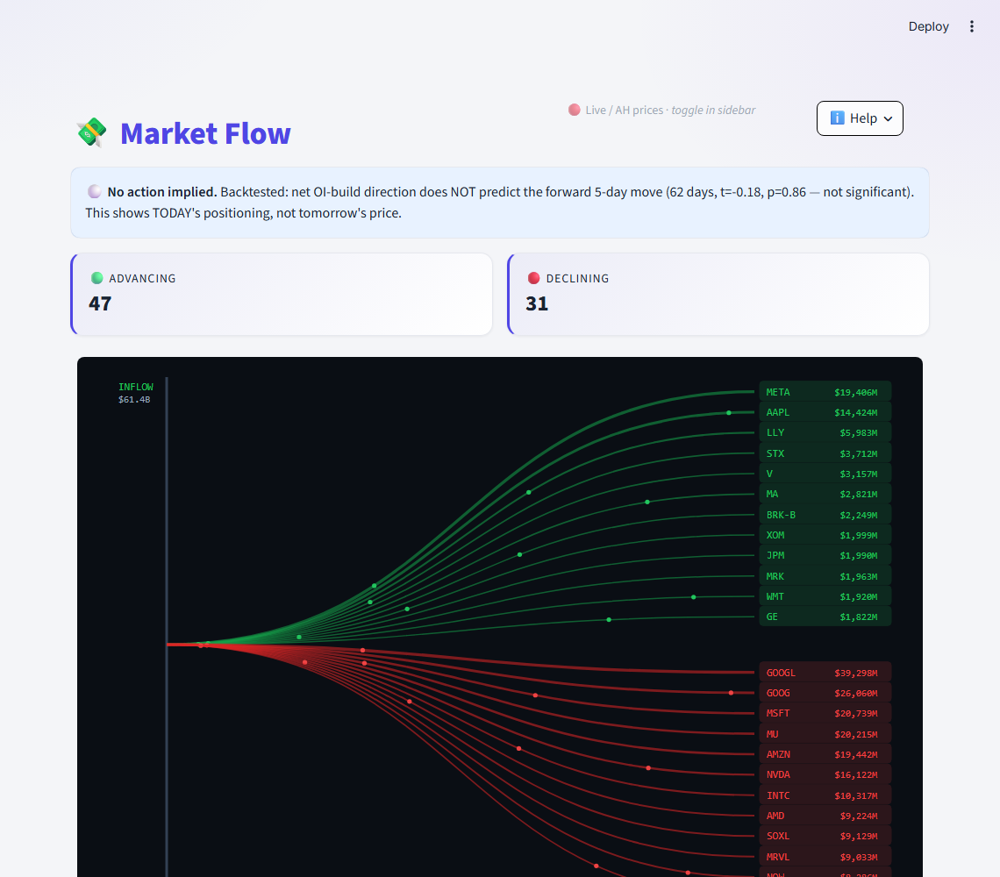
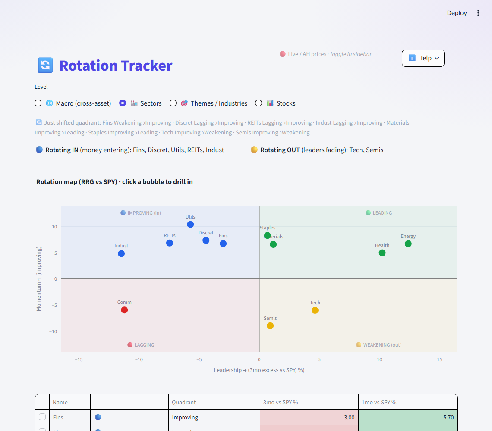
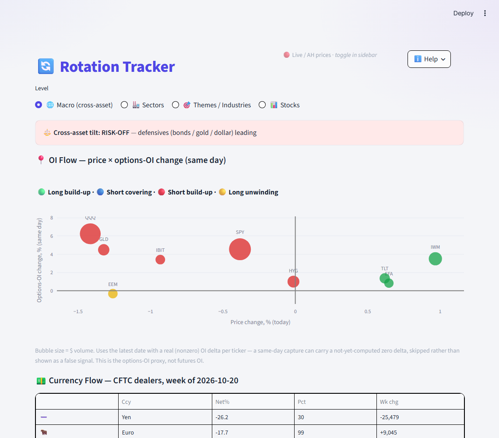
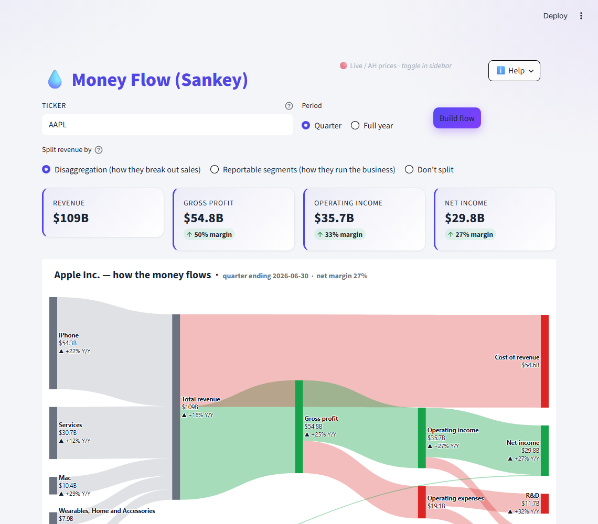
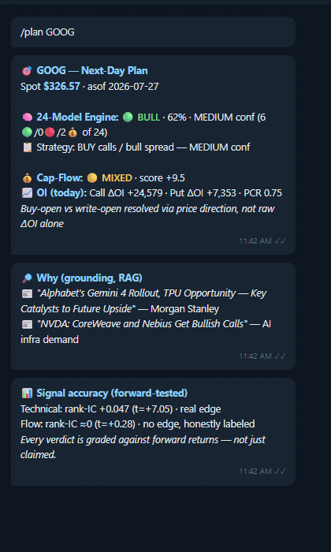
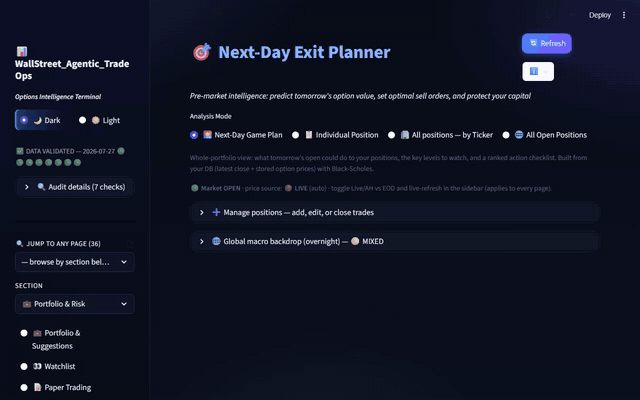
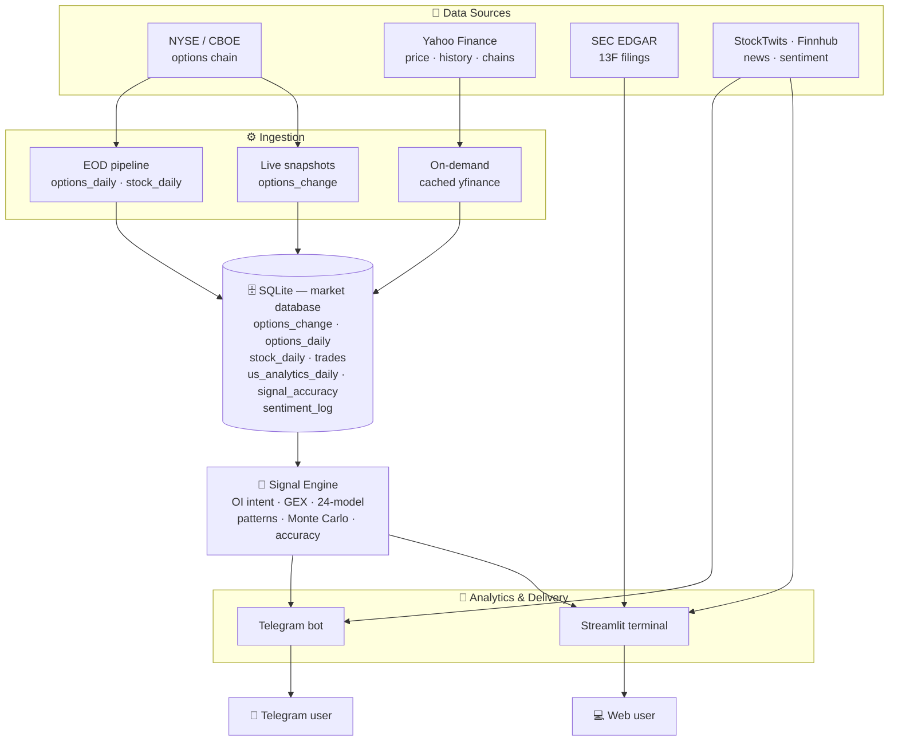
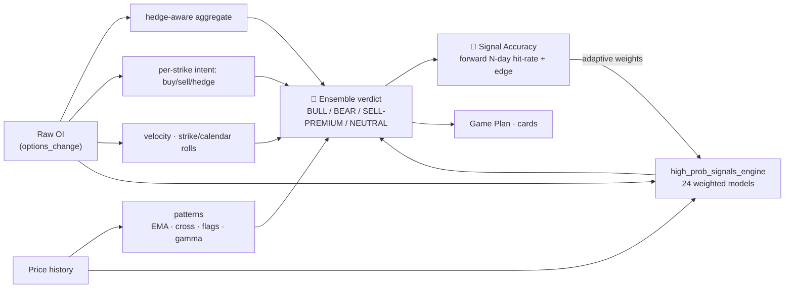
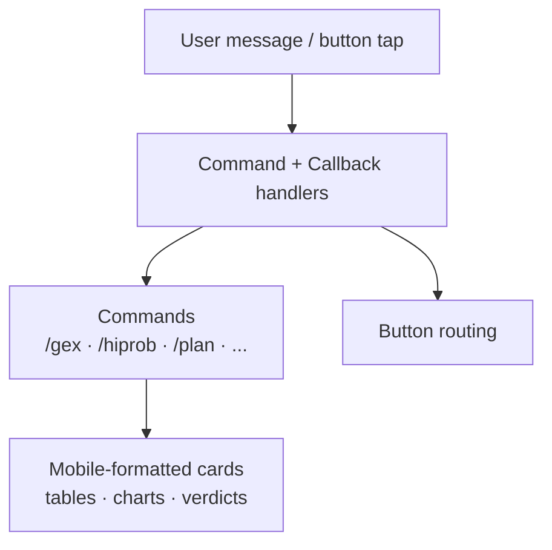

# 📊 WallStreet Agentic TradeOps — Options Intelligence Terminal

> An end-to-end **US options analytics platform** that turns raw NYSE/CBOE options-chain data into actionable, *explained* trade intelligence — delivered through both a **Streamlit web terminal** and a **Telegram bot**.

Built on Open Interest flow, dealer gamma positioning, a 24-model signal ensemble, options-pricing math (Black–Scholes + Monte Carlo), and a forward-tested **signal-accuracy** layer that keeps every signal honest.

**This is a showcase repo — screenshots, GIFs, a video tour, and a description. No source code.** The engine lives in a private repository.

### Why it's different
- 🧠 **Explained, not black-box** — every verdict shows the *why* (OI intent, gamma regime, term structure), not just a number.
- 🎯 **Adaptive accuracy** — each of 24 models is weighted by its *recent* forward hit-rate (logged in `signal_accuracy`), so what's been right lately counts for more.
- 📱💻 **One engine, two surfaces** — the same analytics delivered to a Telegram bot *and* a Streamlit terminal.

---

## 🚀 Coming soon: WallStreet AI Ops — early access

🌐 **[somu-analyst.github.io/WallStreet_Agentic_TradeOps](https://somu-analyst.github.io/WallStreet_Agentic_TradeOps/)**

A first look at what's next. A sample, not the full set:

- 💸 **Market Flow:** where money is moving today, as a live ribbon of inflow and outflow names.
- 🔄 **Rotation Tracker:** which sectors and themes are gaining leadership and which are fading.
- 💧 **Money Flow:** how a company's revenue turns into profit, as one picture.
- 🧭 **Trade Decision Timeline:** an institutional-desk check, step by step, before you place a trade.
- 📱 **Telegram:** the same views and alerts on your phone.

**…and many more exciting features on the way.**

| 💸 Market Flow | 🔄 Rotation: sectors |
|---|---|
|  |  |
| **🔄 Rotation: cross-asset** | **💧 Money Flow (Sankey)** |
|  |  |
| **📱 Telegram** (illustration with real bot output) | |
|  | |

👉 **[Request early access](https://github.com/somu-analyst/WallStreet_Agentic_TradeOps/issues/new?template=early-access.yml)** · [Teaser video (MP4, 20 s)](assets/media/next/teaser.mp4)

Real market data. For information only, not investment advice.

---

## 🎬 Demo

**🖥️ Streamlit terminal** — a real walkthrough: Next-Day Exit Planner → Market Overview → the 24-model High-Prob Engine (run live on GOOG) → OI Analytics → Signal Accuracy Lab.

📹 **[Full video tour — all 35 pages](assets/media/dashboard-full-tour.mp4)** (MP4, ~2 min, ~5 MB). GitHub doesn't inline-preview committed MP4s (only files dragged into its web editor get a native player), so this opens/downloads rather than plays in place.

**📱 Telegram bot** — a styled chat mockup populated with **real, live-pulled output** from `high_prob_signals_engine`, `compute_capflow`, and the verdict-grounding RAG layer (actual GOOG numbers, actual headline hits) — not an actual phone screenshot, but not fabricated numbers either.

---

## ✨ What it does

| Pillar | What you get |
|---|---|
| **OI Flow Analytics** | Buying vs selling vs hedging per strike, ΔOI across strikes *and* across expiries (calendar), gamma walls, max pain, PCR |
| **24-Model Ensemble** | A high-probability signal engine combining GEX, PCR-Z, IV skew, volume profile (VRVP), term structure, smart-money UOA, momentum and more — each model weighted by its *recent* accuracy |
| **Next-Day Game Plan** | Per-position scenario analysis: portfolio Greeks, VaR/CVaR, Monte-Carlo P&L distribution, hold-vs-close debate, execution timing, after-hours-aware pricing |
| **Technical Patterns** | EMA sequence (8/21/50), golden/death cross, bull/bear-flag continuation, dealer gamma regime ("golden gamma" flip) |
| **Signal Accuracy Lab** | Every signal backtested against the forward N-day move — hit-rate, directional edge, and walk-forward — so you know what actually works |
| **Smart Money** | SEC EDGAR 13F history pipeline, legendary-investor tracker, insider / congress / dark-pool signals |
| **Cross-asset rotation** | An RRG-style leadership/momentum map across equities, bonds, gold, commodities, and crypto, plus a per-asset options-OI flow view |
| **Global / Macro** | Cross-market regions, future-growth themes, macro backdrop, institutional research & white-paper feeds |
| **Sentiment** | News tone + StockTwits/Finnhub crowd, forward-logged and scored alongside the hard signals |

---

## 🏗 System architecture

---

## 🔁 Signal pipeline

The **adaptive-weight loop** is the core idea: each model's recent forward accuracy feeds back as a weight, so models that have been right lately count for more.

---

## 🖥 The Streamlit terminal

Organized into navigable sections (dark fintech theme by default, light minimal toggle):

- **📈 Markets & OI** — Market Overview, OI Comparison Charts, OI Analytics & Prediction
- **💡 Trade Ideas** — Prop Trading Screen, 24-Model High-Prob Engine, Gamma Wall Advisor, Live Momentum Scanner
- **💼 Portfolio & Risk** — Portfolio & Suggestions, Live Position Predictor, Trade Risk Calculator, Next-Day Exit Planner / Game Plan, Backtest Lab, Signal Accuracy
- **🏛 Smart Money & News** — Insider / Congress / Whales, Legendary Investors (13F), Smart Money Hub, News & Calendar
- **🌍 Global / Macro** — Global Opportunities, Macro/Event Hub, Rotation Tracker

---

## 📱 The Telegram bot

---

## 🧰 Tech stack

- **Python** · pandas · numpy · scipy
- **Streamlit** (web terminal) · **python-telegram-bot** (bot)
- **Plotly** (charts) · **SQLite** (storage)
- **yfinance** (prices/chains) · **SEC EDGAR** (13F) · **StockTwits / Finnhub** (sentiment)
- Quant: Black–Scholes greeks & pricing, implied-vol solver, GBM Monte Carlo, historical VaR/CVaR

---

## ⚠️ Disclaimer

Personal project, for educational and research purposes only. All signals, scenarios, and scores are derived from historical data plus statistical/Black–Scholes modeling and are **not financial advice**. Options trading carries substantial risk. Real fills, IV shifts, and gaps will differ from any model output. Market data used under personal-use licensing — this showcase contains no live quotes, positions, or vendor-data redistribution. Do your own research.
